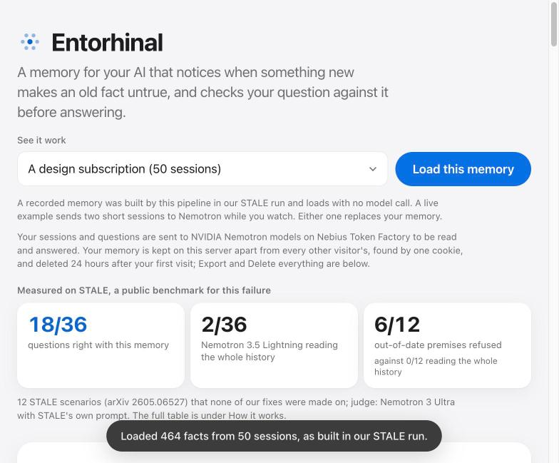
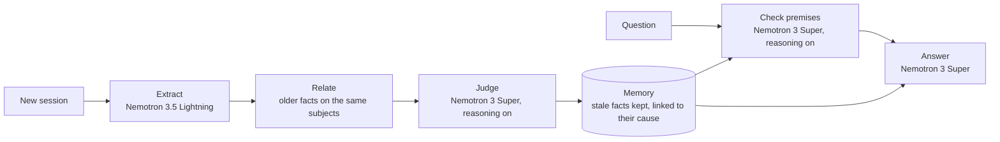

# Entorhinal

**A memory for your AI that notices when something new makes an old fact untrue, and checks your question against it
before answering.** Built on NVIDIA Nemotron models served by Nebius Token Factory, and measured on the public STALE
benchmark.

**Live demo:** https://entorhinal.onrender.com · **Track:** Personal AI · **Licence:** [MIT](LICENSE) ·
**Technical documentation:** [docs/TECHNICAL.md](docs/TECHNICAL.md)



The name comes from the entorhinal cortex, the gateway through which new experiences reach the hippocampus to become
long-term memories.

## The problem

A personal AI that remembers your life keeps acting on facts that something newer has quietly made untrue. You told it
you bike to work every day; three weeks later you mention your leg is in a cast; it still suggests a bike route.
Nothing in the second message says "I no longer bike", so neither keyword search nor embedding similarity links the
two. The longer the history, the more of these silent changes it holds.

It is for anyone who keeps a long history with a personal AI: a researcher over a PhD, a founder running a one-person
company, anyone across a life.

## What it does

- **Remembers in dated facts.** Each conversation becomes facts about the user, each dated by its session.
- **Notices change when it arrives.** For every new session, a reasoning model decides which older facts it makes
  untrue, directly ("we moved to Abu Dhabi") or by consequence ("my leg is in a cast" ends the daily bike ride), and
  marks them stale, linked to the fact that changed them, with the date and the reason.
- **Checks the question before answering.** It lists what the question assumes about you, checks each assumption
  against the memory, and corrects an outdated one first, citing the newer fact and its date, then answers for your
  situation now.
- **Keeps every correction traceable.** Nothing that goes stale is deleted; the timeline shows what changed, when and
  why.

## Results

Measured on [STALE](https://arxiv.org/abs/2605.06527), 12 scenarios (seed 11, six of each type) that none of our
fixes were made on, three questions each, judged by Nemotron 3 Ultra with STALE's own judge prompt at temperature 0
([report](docs/reports/09-measured-run/README.md)). The memory adds to the model it runs on: the same Nemotron 3 Super
that answers in our pipeline got 6 of 36 reading the whole history, and 18 of 36 with the memory. The 550B
Nemotron 3 Ultra reading the whole history also got 6.

| | T1 SR | T1 PR | T1 IPA | T2 SR | T2 PR | T2 IPA | Correct | Overall |
|---|---|---|---|---|---|---|---|---|
| Nemotron 3.5 Lightning reading the whole history | 0/6 | 0/6 | 2/6 | 0/6 | 0/6 | 0/6 | 2/36 | 5.6 % |
| Nemotron 3 Super reading the whole history, reasoning on | 1/6 | 0/6 | 5/6 | 0/6 | 0/6 | 0/6 | 6/36 | 16.7 % |
| Nemotron 3 Ultra reading the whole history, reasoning on | 1/6 | 0/6 | 1/6 | 3/6 | 1/6 | 0/6 | 6/36 | 16.7 % |
| **Entorhinal** (Lightning extracts; Super judges, checks and answers) | 3/6 | 4/6 | 5/6 | 2/6 | 2/6 | 2/6 | **18/36** | **50.0 %** |

T1 is a direct change, T2 an implied consequence. SR: knows the old fact may be outdated. PR: refuses a premise that
rests on it. IPA: plans for the new situation. Overall is the mean of the six cells, as in STALE's own table.

- **Cost:** about $0.37 to build a 50-session memory and answer its three questions, at Nebius list prices; after
  that, one question costs $0.009 to $0.012 in the recordings (a live one on the demo cost $0.016). Reading the whole
  history for the same 36 answers cost $1.43 on Super and $4.80 on Ultra, judge included.
- **Ultra's cut-off answers:** two of its 36 answers were still cut off after a retry at 32,000 output tokens and count
  as wrong; with both right it would be 8 of 36.
- **For context only:** STALE's published table (a different judge, Gemini-3.1-flash-lite, on all 400 scenarios) gives
  the authors' own memory system (CUPMem) 68.0, Claude Opus 4.6 28.3, GPT-5.4 15.7, mem0 8.3 and Zep 6.0. Judge and sample differ, so we do not rank
  ourselves against those rows.

## Safety: it does not agree with you when you are wrong

A model that goes along with an outdated assumption gives confident, wrong advice. STALE measures this directly as
premise resistance: does the system refuse a question that rests on a fact that is no longer true? Entorhinal refused
6 of 12. Reading the whole history, Nemotron 3 Super refused none and Nemotron 3 Ultra one. In the demo's first
example, Super reading all 50 sessions told someone who had cut their internet line that renewing a cloud design
subscription "sounds like a solid plan"; the same Super with the memory answered that they work offline now.

The check is grounded in the memory: it can flag only a fact the memory holds as stale, and what replaced it, and
when, is read from the memory, not from the model's reply. Every correction is shown with its source fact and date, so
a person can verify it. Its known weakness is the opposite error: on long memories the change judge also marks some
unrelated facts untrue (see Limitations).

**Privacy in the hosted demo:** each visitor's memory is a separate file found only by their own cookie, deleted after
24 hours, exportable and deletable at any time. The page loads nothing from any other origin (`Content-Security-Policy:
default-src 'self'`, enforced by a test). Sessions and questions go to Nebius Token Factory to be read and answered,
and the page says so before anything is sent. It flags contradictions for a person to review; it is not medical or
financial advice.

## The demo

Open https://entorhinal.onrender.com (a free instance: the first visit after a quiet spell can take up to a minute).

1. **The first screen** shows the measured result and loads a real memory by itself: a whole STALE life of 50 sessions
   and about 700,000 characters of chat, as this pipeline built it, 464 facts with 18 marked untrue. No model call.
2. **Same question, two systems:** the scenario's question with both answers recorded in our benchmark run, side by
   side, each with the judge's verdict: Nemotron 3 Super reading all 50 sessions (wrong) and Entorhinal, its premise check
   first (right).
3. **Timeline and live pipeline:** every fact, oldest first; stale ones struck through with what replaced them; the
   fact the check relied on is marked. A three.js scene lays the memory out in time and moves only on real events.
4. **Ask it live:** runs the premise check and the answer on Nemotron 3 Super now, with each call's time, tokens and
   price in the log.
5. **Live examples:** two short sessions sent to Nemotron while you watch (a cast, a sold car, a move, and one where
   nothing changed), then a question.

A daily spend cap ($0.80, about 50 live questions) keeps the public demo running; recorded memories are always free.

## How it works



| Stage | Model | What it does |
|---|---|---|
| Extract | Nemotron 3.5 Lightning, JSON mode | the facts the user revealed in the session, dated |
| Relate | none | every active fact on a subject the new facts touch, oldest first, no cap |
| Judge | Nemotron 3 Super, reasoning on | lists only the old facts the session makes untrue, implied consequences included, each with its cause and a reason |
| Store | none | marks those facts stale in one SQLite file per user; nothing is deleted |
| Check | Nemotron 3 Super, reasoning on | each assumption in the question: SAFE, OUTDATED or UNRESOLVED; OUTDATED names the stale fact |
| Answer | Nemotron 3 Super | corrects an outdated assumption first, citing the newer fact and its date, then answers |

[docs/TECHNICAL.md](docs/TECHNICAL.md) covers each stage's contract, the model client, the web app, the evaluation,
the tests and the known defects in full.

## Built with NVIDIA Nemotron on Nebius Token Factory

**Models, and why each stage uses the one it does:**

| Model (Token Factory id) | Used for | Why |
|---|---|---|
| Nemotron 3.5 Lightning (`nvidia/Nemotron-3_5-Lightning`) | extraction, and the benchmark's whole-history baseline | it reads every session; at $0.06 / $0.24 per million input / output tokens it keeps a 50-session life cheap |
| Nemotron 3 Super (`nvidia/nemotron-3-super-120b-a12b`), reasoning on | judging change, checking premises | the judgement that needs reasoning: with reasoning off, Super missed both changes in our first pilot |
| Nemotron 3 Super, reasoning off | the answer | fast once the facts and the premise report are given |
| Nemotron 3 Ultra (`nvidia/Nemotron-3-Ultra-550b-a55b`) | the benchmark judge, and a whole-history baseline | the strongest model, kept out of the product's path |

**Where Token Factory accelerated our work:**

- **One endpoint, every Nemotron model.** The OpenAI-compatible API meant the whole client is about 15 lines of
  Python's standard library, and trying a different model for a stage was a one-string change. That is how we measured
  the change judge: Ultra found the changed fact 2 of 2 but used 11,832 of its 12,000 output tokens at $0.0485 a call;
  Super found 1 of 2 at $0.0082. We chose Super for headroom and cost.
- **Reasoning per call.** `enable_thinking` switches reasoning on only where judgement matters (judge, check) and off
  where speed matters (extract, answer), and the reasoning arrives apart from the answer.
- **Published prices.** The public price catalog let us price every call from its token counts: the benchmark runner
  refuses to spend past its cap, the demo enforces its daily cap, and the page shows each call's cost live.
- **Throughput.** The measured run, 12 scenarios of 50 sessions each, processed one session at a time, finished in
  about 60 minutes with five scenarios in parallel.

**Other Nebius services:** none. All inference runs on Token Factory; the demo is hosted on Render's free tier.

## Run it locally

Requires Python 3.12 and [uv](https://docs.astral.sh/uv/); the server uses only the standard library.

```bash
git clone https://github.com/SharminSirajudeen/entorhinal && cd entorhinal
uv sync
export NEBIUS_API_KEY=...        # a Nebius Token Factory key
uv run python -m app.server --port 7860 --dir memories
```

Open http://127.0.0.1:7860. Memories live under `--dir`, one SQLite file per browser. The day's spend is capped at
$0.80 (`DAILY_CAP_USD` in `life/constants.py`) and kept in `memories/spend.db`, or in a Valkey/Redis store when
`SPEND_URL` names one.

**Tests** (no key needed; every model reply is recorded or scripted):

```bash
npm ci                 # the duplication checker
bash scripts/gate.sh   # lint, duplication, 196 tests, the floor guard, 242 mutants
```

## Use with Hermes Agent

`hermes_provider/` is a memory provider for [Hermes Agent](https://github.com/NousResearch/hermes-agent): each turn,
what the user said is ingested; before the agent answers, any assumption in the question that a newer fact has made
untrue is listed with the newer fact and its date. Install steps and what leaves the device:
[hermes_provider/README.md](hermes_provider/README.md). It is tested against Hermes's `MemoryProvider` interface; it has
not yet been run inside a real Hermes.

## Reproduce the benchmark

These commands need `NEBIUS_API_KEY` and spend real money; each prints its projected cost first and refuses to run
above `--cap`.

```bash
curl -L -o data/T1_T2_400_FULL.json https://huggingface.co/datasets/STALEproj/STALE/resolve/main/T1_T2_400_FULL.json
python -m bench.run --condition baseline       --n 6 --seed 11 --cap 0.9 --out results/measured-run
python -m bench.run --condition baseline-super --n 6 --seed 11 --cap 2.9 --out results/measured-run
python -m bench.run --condition baseline-ultra --n 6 --seed 11 --cap 8.5 --out results/measured-run
python -m bench.run --condition ours           --n 6 --seed 11 --cap 4.2 --out results/measured-run
```

Every experiment, with its code, data and spend, is in [docs/reports/](docs/reports/README.md).

## Limitations

- **Small sample:** 12 scenarios. On 9 others, grading the same answers twice moved premise resistance from 6/9 to 7/9.
- **Implied consequences are the weak side:** 6/18, against 12/18 for direct changes.
- **Over-flagging:** on long memories the change judge also marks some unrelated facts untrue; the demo's "Only the
  facts made untrue" filter shows them.
- **Cut-off replies:** in the measured run, 52 of about 580 change-judge calls stopped at their token cap and were
  refused, so their sessions may hold changes the memory never recorded. A strict expected-failure test pins this.
- **Preferences:** on PrefEval at 300 turns, the memory followed a stated preference 17 of 38 times, against 29 of 38
  for plain retrieval ([report 10](docs/reports/10-prefeval-reply-check/README.md)).
- **Different judge:** our judge is Nemotron 3 Ultra, not the paper's Gemini-3.1-flash-lite, so our numbers are not
  comparable one-to-one with the paper's.
- **Changed since the measured run, not re-measured:** the extraction prompt's session-time sentence
  ([report 08](docs/reports/08-false-flags/README.md)) and the tolerant `FINAL:` marker.

## Repository layout

| Path | Contents |
|---|---|
| `life/` | the memory: types, store, write path, read path, model client, constants |
| `app/` | the web app: server, daily cap, static page, long examples |
| `bench/` | STALE sampling, the benchmark runner, STALE's judge prompt |
| `hermes_provider/` | the Hermes Agent memory provider |
| `tests/`, `test/` | the test suite, goldens, recorded replies; the floor guard and mutants |
| `docs/` | technical documentation, experiment reports |
| `results/` | the benchmark rows behind the results table |

## Credits and licence

Entorhinal is measured on the STALE benchmark (Chao, Bai, Sheng, Li, Sun; arXiv 2605.06527), from the paper that
defined this problem; it provides the test scenarios (CC BY 4.0) and the judge prompt (MIT); its distractor sessions derive from LongMemEval (Wu et al., MIT). three.js r170 (MIT) draws the scene. What is
included, where and under which licence: [NOTICE.md](NOTICE.md).

Entorhinal is released under the [MIT licence](LICENSE).
