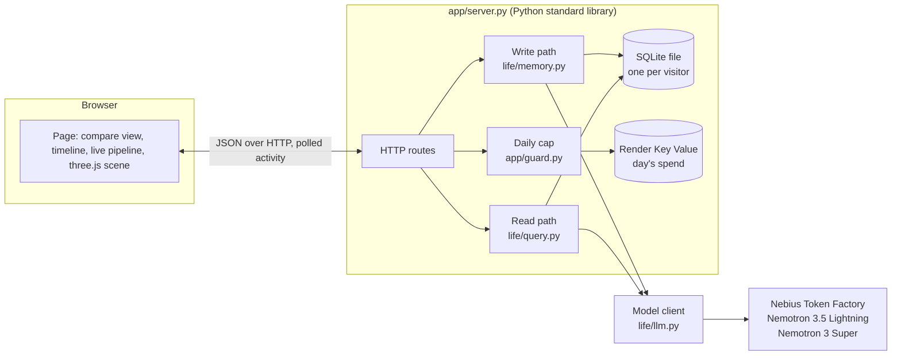

# Entorhinal: technical documentation

Entorhinal is a long-term memory for a personal AI. It stores what a user reveals about themselves as dated facts,
decides with a reasoning model when a newer fact makes an older one untrue, and checks every question's assumptions
against those decisions before it answers. It runs on NVIDIA Nemotron models served by Nebius Token Factory, and it is
measured on STALE, a public benchmark for exactly this failure.

This document describes the system as built: the problem, the architecture, every stage of the pipeline, the model
client, the web app, the evaluation and its results, the tests, the deployment, and the known limits. Every number in
it comes from the code or from a report in `docs/reports/`.

---

## 1. The problem

A memory that only adds facts and retrieves them treats every stored fact as equally true. When something new changes
the user's situation, the old fact is still retrieved, and the model answers from it:

- **A direct change:** "I live in Dubai" is followed months later by "We moved to Abu Dhabi". A question about gyms near
  home should not be answered for Dubai.
- **A change by consequence:** "I bike 10 miles to work every day" is followed by "My leg is in a cast for six weeks".
  Nothing says "I no longer bike", yet a bike-route suggestion is now wrong.

The second kind is the hard one: no keyword or embedding links "cast" to "commute". STALE (arXiv 2605.06527) builds
long user histories around both kinds and asks three questions per scenario:

| Dimension | What it tests |
|---|---|
| SR, state resolution | Does the system know the old fact may be outdated? |
| PR, premise resistance | Does it refuse a question that rests on the outdated fact? |
| IPA, implicit policy adaptation | Does it plan for the user's new situation? |

In our measured run, Nemotron 3.5 Lightning reading the user's whole history in one prompt (STALE's own baseline)
answered 2 of 36 such questions correctly, and none of the 12 premise-resistance questions.

## 2. Approach

Entorhinal makes *no longer true* a state in the memory, decided once, when the change arrives, instead of hoping a
model notices it at question time among hundreds of facts.

1. **Write path, once per session:** extract the facts the user revealed, find the older facts they could affect, and
   ask a reasoning model which of those the new facts make untrue. Mark those stale, linked to the fact that changed
   them and the model's reason.
2. **Read path, once per question:** list what the question assumes about the user, check each assumption against the
   memory, and correct an outdated one first, citing the newer fact and its date, before answering.

The memory never deletes a fact that goes stale. Each correction keeps its chain: old fact, new fact, date, reason.

## 3. Architecture



| Module | Responsibility |
|---|---|
| `life/types.py` | Frozen dataclasses: `Session`, `Fact`, `Decision`, `PremiseReport`, `Answer`, and STALE's `Instance` and `EvalRow` |
| `life/store.py` | The memory: one SQLite file per user |
| `life/memory.py` | The write path: extract, relate, judge, store |
| `life/query.py` | The read path: premise check, answer |
| `life/llm.py` | The only code that calls a model: request, retries, reasoning handling, refusal of cut-off replies, price, replay cache |
| `life/constants.py` | Model ids, prices, the daily cap |
| `app/server.py` | HTTP server, per-visitor memories, live activity log, long examples |
| `app/guard.py` | The hosted demo's daily spend cap and its ledger |
| `app/static/` | The page: `index.html`, `app.js`, `app.css`, `scene.js`, vendored three.js r170 |
| `bench/` | STALE sampling, the benchmark runner, STALE's judge |
| `hermes_provider/` | A memory provider for Hermes Agent |

There are no runtime dependencies beyond the Python standard library. The model client is about 15 lines of
`urllib`.

## 4. Data model

A **fact** is one thing the user revealed, dated by the session it came from:

| Field | Type | Meaning |
|---|---|---|
| `id` | text | `s<session>f<n>`, unique per memory |
| `subject` | text | who or what the fact is about; `user` for the user |
| `attribute` | text | e.g. `commute`, `home_city`, `health` |
| `value` | text | a short phrase |
| `time` | text | the session time, `YYYY-MM-DD HH:MM`; facts sort by this string |
| `source_idx` | int | the session index |
| `status` | `active` or `stale` | held to these two values by a CHECK constraint |
| `invalidated_by` | text or null | the id of the newer fact that made this one untrue |
| `reason` | text or null | the change judge's one-sentence reason |

The **store** (`life/store.py`) is one SQLite table with `id` as primary key. `put` inserts or replaces facts by id in
one transaction; marking a fact stale is a replace with `status = 'stale'`, `invalidated_by` and `reason` set.
`timeline()` returns every fact ordered by time then id; `active()` and `stale()` filter by status; `export_json()`
returns every fact, stale ones included. Only `delete_all()` removes anything.

## 5. Write path (`life/memory.py`)

### 5.1 Extract

- **Model:** Nemotron 3.5 Lightning, reasoning off, JSON mode, up to 1,500 output tokens.
- **Input:** the session's turns, headed by the session time.
- **Contract:** `{"facts": [{"subject", "attribute", "value"}]}`, one entry per fact the user reveals about themselves
  (situation, work, health, location, possessions, plans, habits, relationships). The prompt states that the session
  time only dates the facts and is not a fact itself: without that sentence, one probe in ten produced a false flag
  (report 08).
- **Validation:** a row missing any of the three fields, or with an empty one, is dropped. A reply that does not parse
  yields no facts, never an exception.

### 5.2 Relate

- **Rule:** every *active* fact whose subject is the subject of a new fact, or whose subject is named inside a new
  fact's value. Case-insensitive. O(active facts).
- **Order:** oldest first, so the change judge's prompt prefix stays the same from one session to the next.
- **No cap.** An earlier version sent only the 40 newest related facts. On a pilot, the fact each scenario changed was
  older than that, so it never reached the judge and the pipeline scored 1 of 6. With no cap, the same two scenarios
  scored 6 of 6 (report 06).

### 5.3 Judge

- **Model:** Nemotron 3 Super, reasoning on, up to 12,000 output tokens.
- **Input:** the related old facts and the new facts, each line `[id] (time) subject / attribute: value`.
- **Contract:** after thinking, a line `FINAL:` and a JSON array listing **only** the old facts that are now untrue:
  `{"old_id", "verdict": "stale" | "changed", "by": <new fact id>, "reason": <one sentence>}`. The prompt names the
  implied kind explicitly ("a broken leg stops cycling") and says most sessions change nothing.
- **Why only the untrue ones:** asking for a verdict on every old fact made Ultra spend 11,832 of its 12,000 output
  tokens on a 326-fact memory; a larger memory would cut the reply off and nothing would go stale.
- **Why Super:** on the two pilot sessions that changed a fact, Ultra found it 2 of 2 at $0.0485 and $0.0283 a call;
  Super found it 1 of 2 at $0.0082 and $0.0049. Super with reasoning *off* missed both. Two sessions are not a quality
  comparison; Super was chosen for headroom and cost, and the measured run uses it.
- **Validation:** decisions naming an unknown old id or an unknown verdict are dropped; an unknown or missing `by`
  falls back to the newest new fact.

### 5.4 Store

New facts are written first. Each decision then rewrites its old fact in place as stale, linked to its cause. Every
stage logs one line in words to the `life` logger (what was extracted, how many related facts, which fact went stale
because of which); the web app turns those lines into the live pipeline view.

## 6. Read path (`life/query.py`)

### 6.1 Premise check

- **Model:** Nemotron 3 Super, reasoning on, up to 8,000 output tokens.
- **Input:** the whole memory, one line per fact; a stale fact's line also says what replaced it, when, and why.
- **Contract:** each assumption the question makes about the user's situation now, with a verdict: `SAFE` (the newest
  related fact supports it), `OUTDATED` (a newer fact contradicts it, implied consequences included) or `UNRESOLVED`
  (the memory says nothing). "Not mentioned" is never `OUTDATED`. An `OUTDATED` verdict names the stale fact it rests
  on.
- **Grounding:** an assumption is flagged only if the fact it names is held as stale in the store. The replacing fact
  and the default reason are read from the store, not from the model's reply, so the check cannot flag a fact the
  memory does not hold or invent what replaced it.
- **Failure:** a reply cut off or unparseable yields an empty report, and the answer step still runs.

### 6.2 Answer

- **Model:** Nemotron 3 Super, reasoning off, up to 2,000 output tokens.
- **Input:** the memory, the premise report (each outdated assumption with its old and new fact), the question.
- **Instruction:** correct an outdated assumption first, citing the newer fact and its date, then answer for the
  user's situation now; do not correct assumptions the check marked safe or unresolved.
- **Result:** `Answer(text, premise_report, cost_usd)`, the cost being both calls at list price.

## 7. Model client (`life/llm.py`)

- **Endpoint:** `https://api.tokenfactory.nebius.com/v1/chat/completions` (OpenAI-compatible), with `NEBIUS_API_KEY`.
- **Every request:** `temperature: 0` and `chat_template_kwargs.enable_thinking` set explicitly. Without
  `enable_thinking: false`, Nemotron writes its reasoning into `content`; with it on, the reasoning arrives in
  `reasoning_content`.
- **The `FINAL:` marker:** with reasoning on, the answer is what follows the last line starting with the marker. Super
  sometimes misspells it (`FIN:`, `FINY:`, `FINYAL:` and others; 94 `FIN:` against 785 `FINAL:` in our recordings), so
  the client accepts any `FIN…:` spelling. Before that fix, 21 of 141 judge replies in a pilot lost their decisions.
- **Cut-off replies:** a reply with `finish_reason: "length"` is refused, never used as if whole. It is still billed,
  so its price is counted against the caller's budget.
- **Retries:** HTTP 429 and 5xx are retried after 5, 20 and 60 seconds (Token Factory answered 529, overloaded, once
  during a run).
- **Price:** each call is priced from its `usage` at Token Factory's list prices, cached input tokens at the cached
  rate:

  | Model | Input | Cached input | Output (USD per 1M tokens) |
  |---|---|---|---|
  | Nemotron 3.5 Lightning | 0.06 | 0.03 | 0.24 |
  | Nemotron 3 Super | 0.30 | 0.06 | 0.90 |
  | Nemotron 3 Ultra (benchmark judge only) | 1.00 | 0.12 | 3.00 |

- **Replay cache:** a response can be recorded under the SHA-256 of its exact request body. With `REPLAY=1`, a missing
  recording raises instead of calling the network, so the test suite can never spend and every benchmark number can be
  recomputed for $0 from the recordings. Only the benchmark records (`record=True`); the web app never writes a
  visitor's words to disk outside their own memory file.

## 8. Web app (`app/server.py`)

A `ThreadingHTTPServer` from the standard library serves one static page and a JSON API.

| Method and path | Does |
|---|---|
| `GET /`, `/app.js`, `/app.css`, `/scene.js`, `/vendor/three.module.min.js` | the page |
| `GET /timeline` | every fact in this visitor's memory, oldest first |
| `GET /export` | the memory as JSON |
| `GET /activity` | this visitor's live events (see below) |
| `POST /ingest` | `{"sessions": [{"time", "text"}]}`: runs the write path on each session, in date order |
| `POST /ask` | `{"question"}`: runs the read path; returns the answer and the premise report |
| `POST /example` | `{"name"}`: replaces the memory with a recorded long example (no model call) |
| `POST /delete-all` | empties this visitor's memory |

- **One memory per visitor.** A visitor gets a random id in an `HttpOnly; SameSite=Strict; Secure` cookie
  (`<issue time>-<22 random characters>`). Their memory is `visitors/<id>.db`. Each request sweeps away memories whose
  cookie was issued 24 hours ago or more. A forged or expired cookie gets a new id and an empty memory.
- **One request at a time per visitor:** a lock per visitor id. `GET /activity` takes no lock, so the page can poll it
  while that visitor's request runs.
- **Live activity:** a logging handler copies each `life` record into the current visitor's event list (newest 200,
  memory only): `{t, step, text, call, ids, labels}`. `step` names the stage (`S4` extract, `S5` relate, `S6` judge,
  `Store`, `S8` check, `S9` answer); `call` carries the model, seconds, tokens and price of a model call; `ids` names the
  facts the stage touched.
- **Input limits:** a body over 1,000,000 bytes is refused (413); malformed JSON is 400; a session must have a
  `YYYY-MM-DD HH:MM` time and non-blank text, and may not be older than the newest fact already stored.
- **Errors:** a failed model call becomes a 502 with its message, never a dropped connection.
- **Security headers:** every response carries `Content-Security-Policy: default-src 'self'`. The page names no
  outside URL at all (a test fails on one), so a visitor's browser contacts no other origin.

### 8.1 Daily spend cap (`app/guard.py`)

The hosted demo pays for its visitors' model calls, so it refuses new work once the day's spend would pass $0.80.

- **Estimate before each request:** the text it will send, at 4 characters per token, priced at Ultra's input rate,
  plus a full 4,000-token reply at Ultra's output rate: deliberately above what Lightning or Super would cost.
- **Ledger:** the day's spend, shared by every visitor. When `SPEND_URL` names a Valkey/Redis store, each call adds its
  price with `INCRBYFLOAT spend:<day>` (the key expires three days later), so the cap survives the web service's sleeps
  and restarts; otherwise the ledger is a SQLite file. If the store cannot be reached, the day counts as spent and paid
  work is refused rather than run uncounted.
- **Deleting a memory never resets the day's spend.**

### 8.2 Long examples

`app/examples/*.json` hold three whole STALE scenarios (50 sessions each, about 700,000 characters of chat) as this
pipeline built them during the measured run: 464, 535 and 481 facts, of which 18, 15 and 25 are stale. Each file also
holds the scenario's planning question and both answers the run recorded to it: Nemotron 3.5 Lightning reading the
whole history (judged wrong on all three) and this memory's premise report and answer (judged right on all three).

`docs/reports/09-measured-run/seed.py` rebuilt them from the run's recordings only (`REPLAY=1`, no key): it re-runs the
write path over all 50 sessions, re-derives our answer with the read path, and asserts the answer equals the one the
run recorded before writing the file. Loading one costs no model call.

## 9. The page (`app/static/`)

- **First screen:** the measured result (18/36 against 2/36, and 6/12 against 0/12 out-of-date premises refused), an
  example picker, and the privacy statement. An empty memory loads the first long example by itself.
- **Same question, two systems:** the scenario's question; Lightning's answer after reading all 50 sessions; this
  memory's premise check and answer; each with the benchmark judge's verdict. Both are labelled as recorded.
- **Timeline:** every fact, oldest first; a stale fact is struck through with what replaced it, when and why; the fact
  the latest check relied on is marked "Caught by the check"; a filter shows only the facts made untrue.
- **Live pipeline:** while a request runs, the page polls `/activity` every 400 ms. The step strip lights the running
  stage; the log prints each event, and each model call's seconds, tokens and price; a counter sums the request's calls,
  tokens and cost.
- **Scene (three.js r170, vendored and hash-pinned):** the memory as a constellation laid out by session time. It
  moves only on real events: new facts fly in from the session's column on extract; the related facts light and a beam
  spans them on relate; a red thread draws from the old fact to its cause when one goes stale; on a question, a probe
  rises, and rays reach each fact the check flagged. Nothing animates on a timer pretending to work.
- **Ask it live, Add your own session:** the read and write paths on demand; four short live examples (a direct
  change, two implied consequences, and one where nothing changed).
- **Accessibility:** step changes are announced through a live region; reduced-motion and reduced-transparency
  preferences are honoured; dark mode follows the system.

## 10. Hermes Agent provider (`hermes_provider/`)

A memory provider for Hermes Agent: each turn, the user's side is ingested on a background thread, queued behind the
previous turn; before the agent answers, the premise check runs (waiting up to 6 seconds) and any outdated assumption is
returned under the recalled context with the newer fact and its date. No hook blocks and none raises. It is tested
against Hermes's `MemoryProvider` interface with scripted test replies; it has not yet been run inside a real Hermes.

## 11. Evaluation

### 11.1 Method

- **Benchmark:** STALE (arXiv 2605.06527; code MIT, data CC BY 4.0), 400 scenarios, each about 50 sessions with one
  change buried among distractor sessions.
- **Sample:** stratified and seeded (`bench/stale.py`); the measured run used seed 11, six scenarios of each type, none
  used while building.
- **Conditions:**
  - `baseline`: Nemotron 3.5 Lightning reads the full history and answers (STALE's own setup);
  - `ours`: each session in time order through the write path into a fresh store, then each question through the read
    path.
- **Judge:** Nemotron 3 Ultra with STALE's own judge prompt, byte for byte, temperature 0. The STALE paper uses
  Gemini-3.1-flash-lite, so our numbers are not comparable one-to-one with the paper's table.
- **Cost accounting:** the runner prints a projected cost, refuses to start above `--cap`, and refuses any call once
  the actual spend reaches it.

### 11.2 Results (`docs/reports/09-measured-run/`)

| | T1 SR | T1 PR | T1 IPA | T2 SR | T2 PR | T2 IPA | Correct | Overall |
|---|---|---|---|---|---|---|---|---|
| Nemotron 3.5 Lightning, whole history | 0/6 | 0/6 | 2/6 | 0/6 | 0/6 | 0/6 | 2/36 | 5.6 % |
| **Entorhinal** | 3/6 | 4/6 | 5/6 | 2/6 | 2/6 | 2/6 | **18/36** | **50.0 %** |

T1 is a direct change, T2 an implied consequence. Overall is the mean of the six cells, as in STALE's own table.

- **Premise resistance:** 6 of 12 against 0 of 12. The memory corrects the user instead of agreeing with an outdated
  assumption; the model reading everything never did.
- **Cost:** about $0.37 to build one 50-session memory and answer its three questions; one question costs $0.009 to
  $0.012 in the recordings (a live one on the design-subscription memory cost $0.016).
- **Speed:** the 12 scenarios ran in about 60 minutes, five at a time.
- **For context only:** STALE's published table (its own judge, all 400 scenarios) gives the authors' own memory
  system (CUPMem) 68.0, Claude Opus 4.6
  28.3, GPT-5.4 15.7, mem0 8.3 and Zep 6.0. Judge and sample differ, so we do not rank ourselves against them.

### 11.3 Other experiments

| Report | Question | Result |
|---|---|---|
| 01 | Does a fact list with change detection beat Nemotron reading everything? | Yes: premise resistance 0/20 → 8/20 |
| 02, 04 | How does the STALE authors' own system compare on the same models? | Overall 17/27 vs our 15/27; ours used 5.7× fewer input tokens, $0.085 vs $0.498 a scenario |
| 05 | Does a dedicated premise check raise premise resistance? | 8/20 → 11/20, within judge noise |
| 06 | Does the one-session-at-a-time write path keep the batch result? | Not as first built (1/6); after two fixes, 6/6 on the same two scenarios |
| 08 | Do unrelated sessions cause false flags? | 1 of 10, then 0 of 10 after one prompt sentence |
| 10 | Does the memory follow a stated preference after ~110,000 tokens (PrefEval)? | No: 17/38, against 29/38 for plain retrieval |

## 12. Testing and quality gates

`scripts/gate.sh` runs, in order, and stops at the first failure:

1. **Lint:** ruff, with cyclomatic complexity ≤ 10, nesting ≤ 3 and at most 40 statements per function, as errors.
2. **Duplication:** jscpd at zero tolerance.
3. **Tests:** pytest on recorded or scripted model replies only (`REPLAY=1`): 196 tests and one strict expected
   failure that pins a known defect (section 15). Expected values are derived by hand from golden scenarios
   (`tests/golden/`), including a two-session STALE excerpt.
4. **Floor guard:** fails a change that skips or narrows a test, deletes a test file, silences a checker, or removes a
   mutant whose guarded line still exists.
5. **Mutation testing:** 242 mutants, each a realistic break of one guarded line (a filter removed, a comparison
   flipped, a cookie flag dropped, a page label changed); each must turn its named test red on its named assertion.

`scripts/ci.sh` runs the whole gate in a fresh clone of the pushed commit and posts the result to GitHub as the commit
status `gate/local`; `scripts/merge.sh` refuses to merge without it.

## 13. Deployment

- **Image:** `Dockerfile`, the Python 3.12 slim base and two folders; no packages installed.
- **Hosting:** `render.yaml` declares a free Render web service built from the Dockerfile and a free Render Key Value
  instance (Valkey 8) reachable only from Render's private network, which holds the day's spend.
- **Secrets:** `NEBIUS_API_KEY` is entered in Render's dashboard and is never in the repository.
- **Free-tier behaviour:** the web service sleeps after 15 idle minutes and takes up to about a minute to wake;
  visitors' memories live under `/tmp` and are lost on restart (they expire after 24 hours anyway).

## 14. Security and privacy

- A visitor's sessions and questions go to Nebius Token Factory to be read and answered; the page says so before
  anything is sent. Nothing goes anywhere else.
- Each visitor's memory is a separate file, found only by their own cookie, deleted after 24 hours, exportable and
  deletable at any time.
- No third-party scripts, fonts or analytics; the CSP forbids any other origin.
- The model's output is shown as text, never parsed as HTML.
- The daily cap bounds what the public demo can spend.

## 15. Limitations and known defects

- **Small sample:** 12 scenarios. On 9 others, grading the same answers twice moved premise resistance from 6/9 to 7/9.
- **Implied consequences are the weak side:** 6/18 against 12/18 for direct changes.
- **Over-flagging on long memories:** the change judge also marks some unrelated facts untrue; the timeline filter
  shows them.
- **Cut-off judge replies:** in the measured run, 52 of about 580 change-judge calls stopped at their token cap and were
  refused, so their sessions may hold changes the memory never recorded. Nothing retries a cut-off reply yet; a strict
  expected-failure test pins this.
- **Growing input:** the change judge reads every active fact on the subject each session, so its input grows with the
  memory.
- **Preferences:** on PrefEval at 300 turns the memory followed a stated preference 17/38 times, against 29/38 for
  plain retrieval: extraction treats every user message as a fact about the user (report 10).
- **No check of the answer's own claims:** the premise check runs before the answer; nothing checks the answer against
  the memory afterwards.
- **Changes since the measured run, not re-measured:** the extraction prompt's session-time sentence (report 08) and
  the tolerant `FINAL:` marker.

## 16. Reproducing

```bash
uv sync && npm ci && bash scripts/gate.sh          # the whole gate, no key needed
export NEBIUS_API_KEY=...                          # your own key
uv run python -m app.server --port 7860 --dir memories
# the benchmark (spends money; prints its projected cost and refuses above --cap):
curl -L -o data/T1_T2_400_FULL.json https://huggingface.co/datasets/STALEproj/STALE/resolve/main/T1_T2_400_FULL.json
python -m bench.run --condition ours --n 6 --seed 11 --cap 4.2 --out results/measured-run
```
